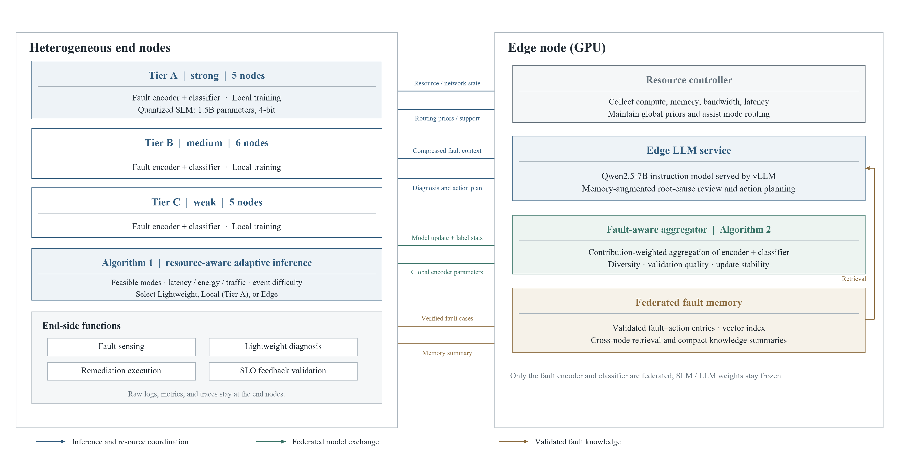

# FedHELM

FedHELM is a research prototype for edge–end fault diagnosis, resource-aware inference, bounded remediation, feedback validation, and federated updates to a compact fault encoder.

The local simulator runs 16 logical end nodes (A5/B6/C5) in a kind Kubernetes cluster hosted by two Docker containers. These are logical nodes, not 16 physical machines. The single setup, operation, data-training, troubleshooting, and physical-node migration guide is [部署说明.md](部署说明.md).

The project keeps model APIs configurable; no provider key is included in the repository. Runtime records, downloaded datasets, model weights, local secrets, and experiment outputs are excluded from Git.
