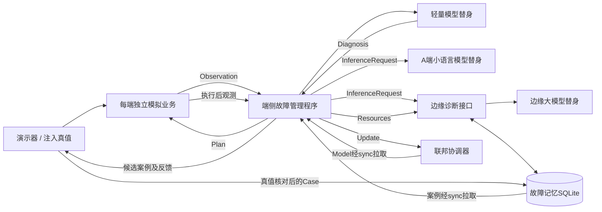

# 原型架构与后续替换位置

> 下文为初始阶段历史架构；最新实际部署分工、真实训练与存储以项目根目录《启动说明.md》第6—8节为准。当前已实现process真实故障、PyTorch端侧训练、SQLite更新持久化；K8s实际部署仍未完成。

## 代码位置

| 文件 | 职责 | 接真实能力时改哪里 |
|---|---|---|
| fedhelm/contracts.py | 统一输入输出定义 | 扩展向量维度、模型清单、真实模式标记 |
| fedhelm/agent.py | 端侧编排、路由、验证、同步 | 自动监测、完整代价算法、真实训练调度 |
| fedhelm/mock_model.py | 替身编码器、分类及模板 | 替换为PyTorch模型 |
| fedhelm/llm.py | 语言模型服务边界 | 增加vLLM/llama.cpp调用、提示及结果校验 |
| fedhelm/edge.py | 边缘诊断、案例与资源 | 资源时效控制、FAISS、大规模案例分页 |
| fedhelm/federation.py | 模拟增量聚合 | 接入Flower、真实参数序列化、论文聚合策略 |
| fedhelm/workload.py | 模拟业务观测与动作 | 实际服务进程、日志、指标与受限执行器 |
| scripts/demo.py | 演示、注入真值和验收 | 换成真实故障注入与独立评估 |

## 为什么暂时不用Kubernetes

当前先验证数据契约和服务互通，独立进程与Compose足够。Kubernetes用于后续节点调度、容器生命周期和集群故障注入，不替代模型、采集器或聚合算法。

以后可将edge/federation/llm部署到带edge标签的worker，将agent及其workload放到对应端worker。A级local-llm应与A级代理放在同一逻辑节点。服务URL改为集群Service DNS，不需要重写业务契约。

## 下一阶段前需要明确

1. 实际运行设备的CPU、内存、GPU和操作系统。
2. 先支持哪些真实故障与处置动作。
3. 轻量模型输入、标签及训练数据来源。
4. 成功判据的阈值、持续时间与真值确认方式。
5. 如果上Kubernetes，是单机kind模拟还是已有集群。

现有接口开放给本机调试，没有认证、授权和生产服务接入。所有启动服务仅用于本任务的模拟原型。
